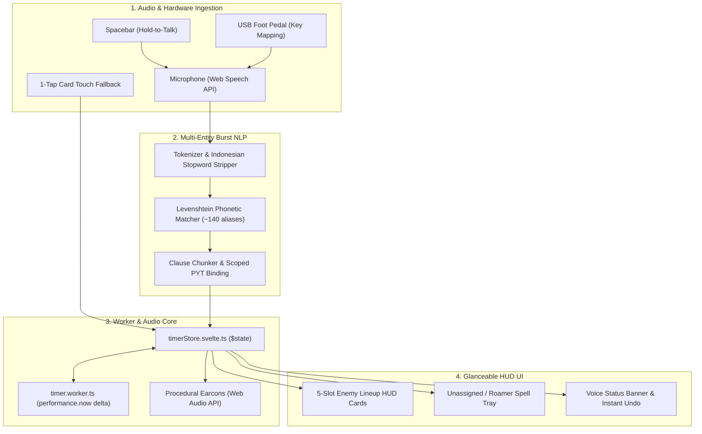

# MLBB Voice Timer (Second Device Audio HUD)

> **High-Precision, Voice-Controlled Enemy Battle Spell Cooldown Tracker for Mobile Legends: Bang Bang (MLBB)**  
> Built with **Svelte 5 (Runes)**, **SvelteKit (SPA Mode)**, **Tailwind CSS v4**, **Web Workers**, and the **Web Audio API**.

---

## Physical Anti-Cheat Isolation (Zero Ban Risk)

Unlike risky on-device overlay tools, MLBB Voice Timer operates under **100% physical hardware isolation**:

- **Runs entirely on a secondary device** (laptop, tablet, or monitor placed beside your phone at a 60–80 cm viewing distance).
- **Zero software interaction** with your primary smartphone running MLBB:
  - No ADB debugging bridge.
  - No local WebSocket or Bluetooth connection.
  - No screen-scraping, OCR, or memory reading.
- **100% immune to Moonton Anti-Cheat Engine (ACE) detection or ban penalties**.

---

## Key Features

### 1. Multi-Entity Burst Speech NLP Engine

- **Single-Breath Multi-Spell Recording**: Track up to 5 enemy spells called out in rapid succession during intense teamfights without pausing.
- **Flexible Syntax Patterns**:
  - **Interleaved**: `[Hero] [Spell]` (e.g., _"Chou fliker"_)
  - **Inverted Interleaved**: `[Spell] [Hero]` (e.g., _"Fliker Chou"_)
  - **Parallel Chunks**: `[Heroes...] [Spells...]` (e.g., _"Chou Hanabi fliker aegis"_)
- **Indonesian Slang & Phonetic Tolerance**:
  - Strips conversational filler stopwords (_"eh", "tadi", "si", "terus", "ya", "udah", "dong"_).
  - Levenshtein phonetic distance tolerance for common Indonesian gaming pronunciation (e.g., _"retri"_, _"flicker"_, _"egis"_, _"purif"_).
- **Scoped Modifier Binding (`hasPYT`)**:
  - The talent emblem _Pull Yourself Together (PYT)_ (-15% spell cooldown) binds strictly to the entity in its local clause.
  - **Zero global leakage**: Saying _"Chou fliker hanabi aegis natan purify pyt"_ correctly applies the -15% cooldown reduction **only** to Natan's Purify, leaving Chou and Hanabi untouched.

### 2. High-Precision Drift-Proof Web Worker Timer

- **Zero Background Throttling**: Standard browser `setInterval` drops accuracy or halts when tabs are minimized or lose focus. Our timer core runs in a dedicated **Web Worker thread** (`src/lib/workers/timer.worker.ts`).
- **Timestamp Delta Calculation**: Measures absolute elapsed time (`Date.now() - startedAt`), ensuring millisecond precision even during 15+ minute minimized background sessions.

### 3. Procedural Audio Earcons (Web Audio API)

- **Zero TTS Distraction**: No robotic text-to-speech reading long sentences that drown out in-game sound cues (e.g., bush ambush sounds) or Discord comms.
- **Micro-Sound Synthesizer**: Generates distinctive 60–80 ms procedural chimes via `OscillatorNode`:
  - **Flicker**: High-frequency sine sweep (600 Hz $\to$ 900 Hz).
  - **Defense (Aegis/Purify)**: Dual harmonic chord (523 Hz & 659 Hz).
  - **Retribution**: Low-frequency punch impact pulse (180 Hz $\to$ 80 Hz).
  - **Spell Ready**: Double chime alert when cooldown completes.
  - **Undo**: Subtle down-sweep blip on cancellation.
- **Zero External Assets**: Operates entirely in code without downloading heavy MP3/WAV audio files.

### 4. Glanceable HUD Interface (Optimized for 70 cm Distance)

- **Mega Tabular Countdown**: Giant `font-black text-5xl sm:text-6xl` tabular mono countdown numbers readable with a split-second glance.
- **3-Tier Visual Urgency Colors**:
  - **Solid Red**: Active cooldown (> 15s).
  - **Pulsing Yellow**: Warning threshold (< 15s) — alerts your team to ganking windows.
  - **Neon Green**: Spell READY.
- **Touch Fallback**: One-tap quick trigger buttons on each hero card for silent manual tracking.
- **Match Setup Modal**: Pre-match 5-lane enemy selector (EXP, Jungle, Mid, Gold, Roam) with automatic default spell binding and PYT toggles.
- **Dynamic Unassigned Spells**: Spells called for heroes not in the 5 assigned lane slots automatically appear in a dedicated "Additional / Unregistered Enemies" tray.

### 5. Instant Undo & Hardware Input

- **Voice Undo**: Say _"batal"_ or _"cancel"_ to instantaneously abort the last launched cooldown timer.
- **Keyboard Shortcuts**: Press `Esc` or `Backspace` for instant undo.
- **Hold-to-Talk `Spacebar`**: Hold down the spacebar while shouting teamfight spell calls.
- **USB Foot Pedal Support**: Mapped to trigger mic streaming so both of your hands stay 100% on your smartphone screen.

---

## Voice Command Cheat Sheet

| Intent                    | Spoken Example (Bahasa Indonesia)             | Parsed Action                                                            |
| :------------------------ | :-------------------------------------------- | :----------------------------------------------------------------------- |
| **Standard Call**         | _"Chou fliker"_                               | Starts 120s cooldown for Chou's Flicker                                  |
| **Inverted Order**        | _"Fliker Chou"_                               | Starts 120s cooldown for Chou's Flicker                                  |
| **Single Hero Default**   | _"Retri Ling"_                                | Starts 35s cooldown for Ling's Retribution                               |
| **Parallel 2-Hero Burst** | _"Chou Hanabi fliker aegis"_                  | Starts Chou Flicker (120s) & Hanabi Aegis (90s)                          |
| **Burst with Scoped PYT** | _"Chou fliker Hanabi aegis Natan purify pyt"_ | Starts Chou Flicker (120s), Hanabi Aegis (90s), and Natan Purify (76.5s) |
| **Instant Undo**          | _"Batal"_ or _"Cancel"_                       | Instantly cancels the most recently started timer                        |

---

## Getting Started

### Prerequisites

- Node.js 18+ or 20+
- npm (or npm.cmd on Windows)

### Installation

```bash
# Clone the repository
git clone https://github.com/user/voice-timer-project.git
cd voice-timer-project

# Install dependencies
npm install
```

### Running the Development HUD

```bash
npm run dev
```

Open your browser and navigate to `http://localhost:5173`.

### Running the Test Suite

```bash
# Run Vitest unit tests (parser, earcons, timer worker, speech manager)
npm run test

# Run Svelte type-checking
npm run check

# Run code style formatting & linting
npm run lint
```

---

## Architecture & Tech Stack



---

## License

MIT License. Built for competitive MLBB players, coaches, and shotcallers.
